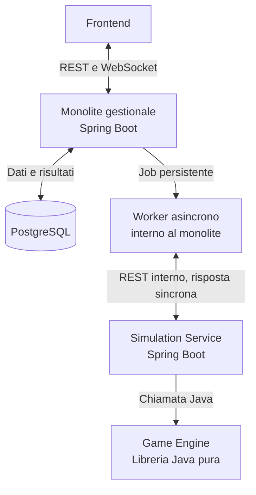

# EchoesWar — Backend

> **Documentazione ufficiale del backend**  
> Linguaggio: Java 25 · Framework: Spring Boot · Database: PostgreSQL

EchoesWar è un gioco di carte collezionabili digitale. Il backend gestisce le funzionalità applicative e delega l'esecuzione delle partite a un motore di simulazione indipendente, scritto in Java puro.

Questo README presenta la **struttura architetturale approvata**, le responsabilità dei componenti e i riferimenti alla documentazione per contribuire al progetto. Le convenzioni di programmazione sono raccolte separatamente in [`CODING_RULES.md`](CODING_RULES.md).

## Indice

- [Panoramica architetturale](#panoramica-architetturale)
- [Componenti e responsabilità](#componenti-e-responsabilità)
- [Flusso di simulazione](#flusso-di-simulazione)
- [Contratti e persistenza](#contratti-e-persistenza)
- [Tecnologie](#tecnologie)
- [Organizzazione del codice](#organizzazione-del-codice)
- [Documentazione ufficiale](#documentazione-ufficiale)
- [Stato delle decisioni](#stato-delle-decisioni)

## Panoramica architetturale

La soluzione è composta da un **frontend indipendente**, un **monolite gestionale Spring Boot**, un **servizio Spring Boot di simulazione** e una **libreria Game Engine Java pura**. Il monolite è l'unico backend esposto al frontend e l'unico componente responsabile della persistenza applicativa in PostgreSQL.



> Il **Worker non è un servizio separato**: è un componente interno del monolite gestionale. **Spring Cloud Gateway non è previsto**, poiché il frontend comunica con un unico backend pubblico.

## Componenti e responsabilità

| Componente | Responsabilità principali |
| --- | --- |
| **Frontend** | Interfaccia utente, richieste REST, ricezione di notifiche WebSocket e riproduzione grafica delle partite. |
| **Monolite gestionale** | Account, catalogo carte, collezione, mazzi, crediti, scambi, sfide, orchestrazione dei job, API e persistenza. |
| **Worker asincrono** | Acquisizione dei job, chiamata al servizio di simulazione, gestione dell'esito e aggiornamento dello stato. |
| **Simulation Service** | Ricezione dello snapshot, invocazione della libreria Java e restituzione del risultato strutturato. |
| **Game Engine** | Regole, turni, scontri, effetti, condizioni di vittoria ed eventi necessari al replay. Non utilizza Spring né accede al database. |
| **PostgreSQL** | Persistenza dei dati gestionali, dei job, dei risultati e dei replay. |

Il **Simulation Service non accede direttamente al database** e non è esposto al frontend. Il **Game Engine** viene incluso come dipendenza Maven del Simulation Service e viene eseguito nella stessa JVM, senza un processo o un container autonomo.

## Flusso di simulazione

La soluzione è **asincrona rispetto al frontend** e **sincrona nella chiamata REST tra Worker e Simulation Service**.

1. Il frontend richiede la creazione di una partita al monolite, tramite `POST /api/v1/matches`.
2. Il monolite valida la richiesta e registra una partita e un job persistente in stato `PENDING`.
3. L'API risponde con **HTTP `202 Accepted`**, includendo l'identificativo della partita e lo stato iniziale.
4. Un Worker interno acquisisce il job e lo porta in stato `RUNNING`.
5. Il Worker invia lo snapshot della partita al Simulation Service tramite una chiamata REST interna.
6. Il Simulation Service invoca il Game Engine come normale libreria Java e restituisce in JSON il risultato della partita e gli eventi dei turni.
7. Il gestionale salva in PostgreSQL risultato e replay, portando il job in stato `COMPLETED`; in caso di errore gestisce lo stato `FAILED`.
8. Dopo il commit, il monolite può notificare il frontend tramite WebSocket. Il frontend recupera gli eventi e riproduce graficamente una partita già calcolata.

Gli stati minimi previsti sono: `PENDING`, `RUNNING`, `COMPLETED`, `FAILED`. Le operazioni di acquisizione e completamento del job utilizzano transazioni distinte: **nessuna transazione database deve restare aperta durante la chiamata HTTP al Simulation Service**.

## Contratti e persistenza

### Snapshot della partita

Il gestionale fornisce al Simulation Service tutti i dati necessari per eseguire la simulazione senza consultare altri servizi o database. Lo snapshot comprende, secondo il contratto da dettagliare:

- identificativo della partita e riferimenti essenziali ai giocatori;
- composizione dei due mazzi da 30 carte;
- definizioni delle carte necessarie al calcolo (una sola definizione per carta, con le relative quantità nei mazzi);
- versione delle regole ed eventuale seed per rendere riproducibile la simulazione.

Le immagini e gli altri dati esclusivamente grafici non fanno parte del payload del motore. I DTO dei due servizi rimangono **separati**, mentre il contratto JSON è **versionato**.

### Risultati e replay

Il Game Engine restituisce il risultato finale e una sequenza ordinata di eventi. Il **monolite** è l'unico responsabile del loro salvataggio.

In PostgreSQL i dati frequentemente interrogati sono conservati in colonne tradizionali, mentre gli eventi e il replay vengono salvati come **`JSONB`**. Il frontend non ricalcola gli scontri: utilizza gli eventi memorizzati per la riproduzione visiva.

Per le entità gestionali si utilizzano **identificativi numerici auto-incrementali**, mappati in Java come `Long`.

## Tecnologie

| Ambito | Tecnologia |
| --- | --- |
| Linguaggio | Java 25 |
| Applicazioni backend | Spring Boot 4.1.x (versione esatta da fissare nella build) |
| Persistenza | PostgreSQL 18, Spring Data JPA / Hibernate |
| Migrazioni | Flyway |
| Build | Maven multi-modulo, Parent POM/BOM |
| API | REST; WebSocket per notifiche |
| Motore di gioco | Libreria Java Standard Library, senza Spring o Lombok |
| Testing | JUnit e test di integrazione nei rispettivi moduli |
| Esecuzione coordinata | Docker Compose |

L'autenticazione è un argomento **non ancora approvato**: la scelta tra JWT gestiti nel monolite e Keycloak sarà documentata separatamente. Non è prevista una configurazione definitiva in questo README.

## Organizzazione del codice

Struttura di riferimento del monorepo:

```text
EchoesWar/
├── backend/
│   ├── pom.xml                      # Parent Maven
│   ├── echoeswar-gestionale/
│   ├── echoeswar-simulation-service/
│   └── echoeswar-game-engine/
├── frontend/
├── docs/
├── docker-compose.yml
├── CODING_RULES.md
└── README.md
```

- Il gestionale e il Simulation Service sono moduli applicativi Spring Boot.
- Il Game Engine è una libreria Java pura utilizzata come dipendenza del Simulation Service.
- Il gestionale **non importa direttamente** il Game Engine: comunica con il Simulation Service attraverso REST.
- L'organizzazione interna dei package, la gestione di DTO, Entity, mapper, eccezioni e repository sono regolate da `CODING_RULES.md`.

> La struttura sopra è quella di riferimento; i percorsi effettivamente presenti nel repository devono essere verificati prima di utilizzare comandi di avvio o build specifici.

## Documentazione ufficiale

| Documento | Contenuto |
| --- | --- |
| [`README.md`](README.md) | Introduzione al backend, panoramica architetturale e flusso di simulazione. |
| [`CODING_RULES.md`](CODING_RULES.md) | Convenzioni ufficiali di programmazione: Java, naming, DTO, JPA, REST, transazioni, OpenAPI, Git e Pull Request. |
| `docs/` | Spazio previsto per specifiche API, schemi del database, contratti di simulazione e documentazione tecnica di dettaglio. |

Per ogni contributo backend è necessario rispettare le regole contenute in [`CODING_RULES.md`](CODING_RULES.md), mantenere aggiornati i contratti API e accompagnare le modifiche con i test pertinenti.

---

*La presente documentazione descrive le decisioni architetturali condivise; le scelte ancora aperte non devono essere interpretate come requisiti già approvati.*
